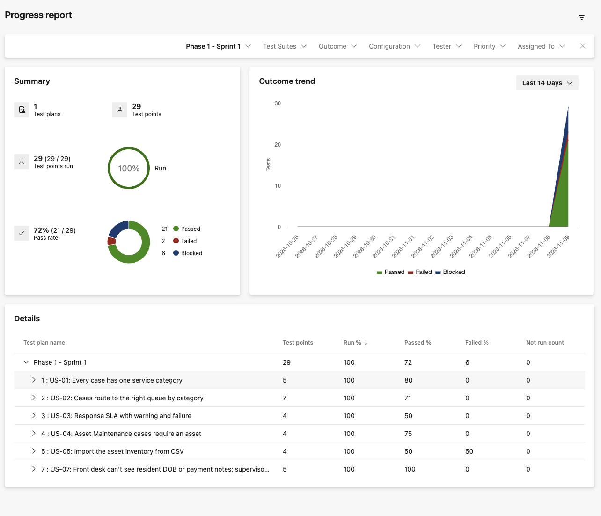
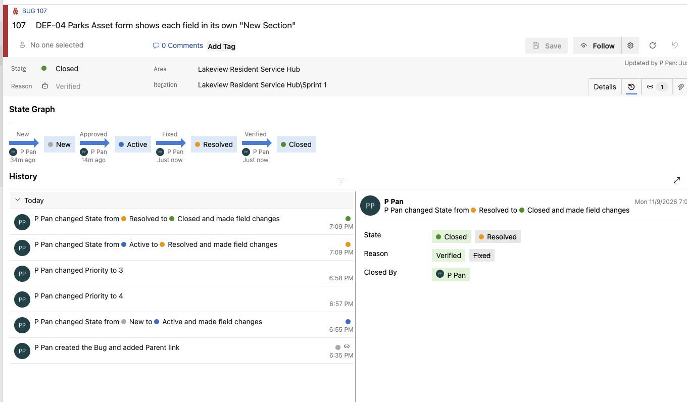
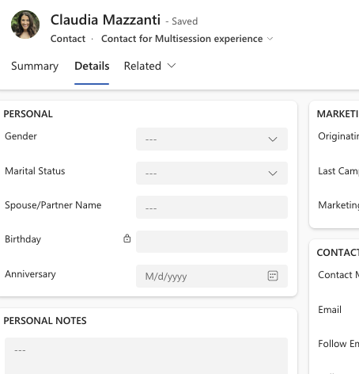
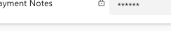
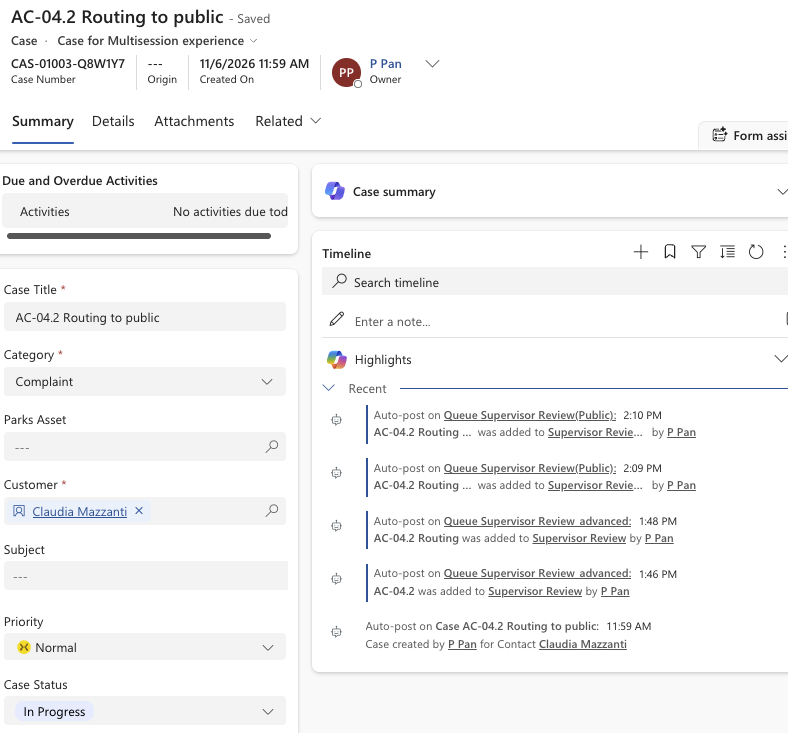

# City of Lakeview Parks & Recreation: Resident Service Hub

> **Independent, self-directed portfolio demo for a fictional city. Not affiliated with any real city or government agency.** All data is synthetic.

**Status:** Phase 1 complete (Nov 2–9, 2026). Phase 2 in progress; items marked *Next phase* aren't built yet. Day-by-day record: [PROGRESS.md](PROGRESS.md).

## What this is

A **Dynamics 365 Customer Service** configuration for a fictional city's Parks & Recreation department, tested through a full **QA lifecycle in Azure DevOps**: requirements → test cases → test runs → bugs → triage → fix and retest → execution report.

Residents contact Parks & Rec about facility rentals, registration problems, refunds, complaints and broken park assets. Staff log cases, which route to team queues and run against a response-time SLA. A small asset extension links maintenance cases to park assets (basic EAM-style tracking; not a full EAM system).

**Audience:** hiring managers for QA and Dynamics 365 / Power Platform roles.

## What was built (Phase 1, verified)

| Area | Configuration |
|---|---|
| **Data model** | Custom **Parks Asset** table (Asset ID with an **alternate key**, type, location, condition, team, status); Case **Category** (5 values, required) and **Parks Asset** lookup (1 asset : N cases) |
| **Business rule** | Entity-scope rule: an Asset Maintenance case must be linked to an asset |
| **Data import** | 30 synthetic assets imported from CSV; negative file tested duplicate, missing and invalid values |
| **Routing** | 5 basic queues; basic routing ruleset (category → queue, catch-all → General Intake) behind a **unified-routing intake rule** |
| **SLA** | Default first-response SLA with a **test item** (5/10 minutes, titles starting `SLA-TEST`) to observe warning, failure and success |
| **Security** | Layered security roles (Front Desk, Supervisor) and **column-level security** on resident date of birth and payment notes |
| **Apps** | Copilot Service workspace (Microsoft's) and a small model-driven app, *Lakeview Parks Assets* |

## Test results

**29 manual test cases** traced to acceptance criteria, in six requirement-based suites in Azure Test Plans.

| Passed | Failed | Blocked | Run |
|---|---|---|---|
| **21 (72%)** | **2** | **6** | 29 / 29 |

- **Failed:** the CSV import accepted assets with a blank ID or name, and **added invalid values as new choice options** while reporting the rows as successful.
- **Blocked:** four tests need Web API POST/PATCH requests (tool set up in Phase 2); SLA pause and the business-hours SLA aren't built yet.
- **Bugs:** 7 logged and triaged; **2 fixed, retested and closed**, 2 deferred to Phase 2, 1 under investigation, 1 resolved as by design, 1 duplicate.

Full report, including limitations and evidence gaps: [docs/test-execution-report.md](docs/test-execution-report.md).

## Findings worth reading

- **Hidden isn't protected:** for the Front Desk user, the secured date of birth showed a lock on the form, and a **Web API query in that user's own session returned `null`**; the Supervisor's session returned the value.
- **Two routing engines:** with unified routing enabled, the basic ruleset silently did nothing until a Case **intake rule** was mapped to it. Diagnosed via the case's background processes (none ran).
- **Import side effect:** the import wizard turned invalid CSV values into new choice options, a data import that changed the schema.
- **Verify the import, not the message:** the first bulk import of test cases created test cases **without steps**; fixed by exporting a hand-made test case and copying ADO's own layout.
- **Time zones:** the Dynamics user time zone defaulted to UTC (found via an 8-hour timestamp offset) and was fixed before SLA testing.

**Front Desk user's view of secured columns** (date of birth hidden; payment notes masked):

**Routing evidence** (case timeline posts each time a case is added to a queue):

## Repository contents

| Path | What |
|---|---|
| [docs/requirements/user-stories.md](docs/requirements/user-stories.md) | 8 user stories, 43 acceptance criteria |
| [tests/manual/test-cases.md](tests/manual/test-cases.md) | 29 test cases (readable) |
| [tests/manual/ado-import/](tests/manual/ado-import/) | Test cases as CSV in Azure Test Plans' import layout |
| [docs/test-execution-report.md](docs/test-execution-report.md) | Results, defects, triage, readiness |
| [docs/asset-import-mapping.md](docs/asset-import-mapping.md) | CSV mapping and expected vs actual import results |
| [data/](data/) | Synthetic asset CSVs (valid and negative) |
| [solution/](solution/) | Exported **unmanaged** solution 1.0.0.1 |
| [docs/solution-export.md](docs/solution-export.md) | What the export contains, what must be recreated, prerequisites |
| [PROGRESS.md](PROGRESS.md) | Decisions, risks, status and evidence log |

## Reproduce it

1. A **Dynamics 365 Customer Service** environment (trial is fine) is required; the solution depends on Microsoft's Customer Service managed solutions.
2. Import `solution/LakeviewResidentServiceHub_1_0_0_1.zip` (unmanaged).
3. Recreate what isn't in a solution (queues, SLA KPI, users, role assignments, data) using [docs/solution-export.md](docs/solution-export.md).
4. Run the test cases from [tests/manual/](tests/manual/) (or import the CSVs into Azure Test Plans).

## Next phase (not built yet)

Requester notification flow (US-06) · business-hours SLA items and SLA timer · fixes for the deferred import defects · Web API test tooling and automated **Playwright** tests with CI · accessibility checks (axe, keyboard) · platform pass on macOS browsers and the Power Apps app on iPhone/iPad · Power BI reporting (US-08) · readiness report and demo script.

## How this was made

Self-directed project. I configured Dynamics 365 and Azure DevOps, ran the tests and made the triage decisions myself. Some documents (user stories US-04 to US-08, the test-case draft) were **drafted with AI assistance and reviewed by me**; this is noted in each file.

## Public-repo rule

No secrets, authentication state, tenant IDs, environment URLs, user emails or real personal data. Screenshots are cropped or redacted.
